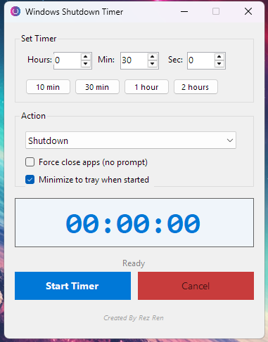

# Windows Shutdown Timer Widget

A simple, lightweight Windows application to schedule shutdown, restart, sleep, hibernate, sign out, or lock workstation with a countdown timer.



## Features

- ⏱️ **Flexible Timer** - Set hours, minutes, and seconds (up to 99 hours)
- 🎯 **Multiple Actions** - Shutdown, Restart, Sleep, Hibernate, Sign Out, Lock Workstation
- 🎨 **Visual Countdown** - Large display with color coding:
  - 🔵 Blue: > 5 minutes remaining
  - 🟠 Orange: < 5 minutes remaining
  - 🔴 Red: < 1 minute remaining
- 📦 **Minimize to Tray** - Runs in background with system tray icon
- ⚡ **Force Close Option** - Force close applications without prompts
- ⚙️ **Preset Buttons** - Quick 10min, 30min, 1hr, 2hr timers
- 🖥️ **Native Windows** - Uses `shutdown.exe` for reliable execution

## Installation

### Option 1: Download Release (Recommended)
1. Go to [Releases](https://github.com/Rezza8/shutdown-timer-widget/releases)
2. Download `ShutdownTimerWidget-v1.0.2.zip`
3. Extract and run `Install.bat` **as Administrator**
4. Creates Start Menu + Desktop shortcuts
5. Adds entry in Add/Remove Programs for clean uninstall

### Option 2: Build from Source
```bash
git clone https://github.com/Rezza8/shutdown-timer-widget.git
cd shutdown-timer-widget/ShutdownWidget
dotnet publish -c Release -r win-x64 --self-contained true -p:PublishSingleFile=true
```
The executable will be in `bin/Release/net10.0-windows/win-x64/publish/`

## Usage

1. Launch **Shutdown Timer** from Start Menu or Desktop
2. Set timer using Hours/Minutes/Seconds or click a preset button
3. Select action from dropdown (Shutdown, Restart, Sleep, etc.)
4. Optionally check "Force close apps"
5. Click **Start Timer**
6. App minimizes to tray (if enabled) - double-click tray icon to restore
7. Click **Cancel** anytime to stop the timer

## System Requirements

- Windows 10 or 11
- .NET 10 runtime (included in self-contained build)

## Uninstall

- Use **Add/Remove Programs** → "Shutdown Timer"
- Or run `Uninstall.ps1` from install folder as Administrator

## Screenshots


## License

MIT License - feel free to use and modify.

## Credits

Created By **Rez Ren**